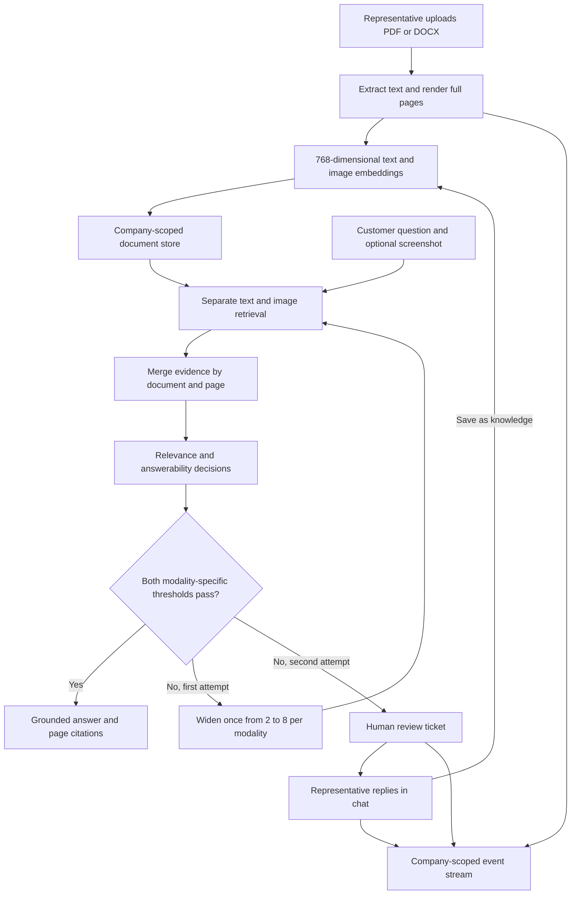

# Multimodal support desk

A runnable support application that answers from company documents only when a decision gate finds sufficient evidence. It searches text passages and whole-page images separately, scores relevance and answerability, widens retrieval once, and opens a ticket when evidence remains insufficient. Representatives reply inside the customer conversation and can turn a reviewed answer into searchable knowledge.

The default mode runs offline with synthetic documents, deterministic embeddings, and transparent scoring heuristics. It demonstrates the entire workflow without downloading model weights or requiring credentials. An optional model service implements real EmbeddingGemma 2 embeddings and d1-3B decisions; an InsForge gateway adapter handles grounded vision generation.

## Run locally

Python 3.11 or later is required. From this directory in PowerShell:

```powershell
python -m venv .venv
.venv/Scripts/python.exe -m pip install -r requirements.txt
.venv/Scripts/python.exe -m uvicorn support_desk.app:create_app --factory --host 127.0.0.1 --port 8766
```

Open [http://127.0.0.1:8766](http://127.0.0.1:8766). On macOS or Linux use `.venv/bin/python` for the same commands.

Try these flows:

1. Ask **How do I reset my password?** for a text answer with page citations.
2. Ask **How do I fix E-4012?** for an answer from a full-page image and its synthetic caption.
3. Ask **Can I request an extended warranty?** to create a ticket. Open **Review inbox**, write a reply, check **Save as knowledge**, and post it in chat. Ask the question again to retrieve the reviewed answer.
4. Switch to **Northstar services**. Its documents, tickets, and knowledge are separate.
5. Upload a PDF in **Knowledge**. The app extracts approximately 220-word chunks and renders every page as PNG. Progress streams to the UI. DOCX uploads require `soffice` or `libreoffice` on PATH; conversion to PDF preserves real page numbers. If unavailable, export the document to PDF first.

All generated files stay in ignored `data/`, or the directory named by `SUPPORT_DATA_DIR`. Failed or incomplete indexing jobs are excluded from retrieval. Uploads are limited to 20 MB and 200 pages.

## How it works



Text relevance, text answerability, image relevance, and image answerability are four separate database settings. A candidate must pass both scores for its modality. Model failures also open a ticket and produce a sanitized decision-log entry. Generation is never called when no evidence passes. Citation IDs must refer to accepted evidence; page images require authentication.

The local backend uses SQLite and private filesystem storage. Bearer tokens map to company, user, and role on the server; caller-supplied company IDs are never trusted. Conversations are readable only by their owning customer identity. Representatives see tickets, settings, upload jobs, and decision logs for their company. Ticket resolution and optional knowledge insertion are atomic, including concurrent replies.

## CODE MAP

| File | Responsibility and connections |
| --- | --- |
| `support_desk/app.py` | FastAPI factory, bearer authentication, role/owner checks, customer and representative routes, upload scheduling, SSE event stream, static UI. Calls ingestion and pipeline modules. |
| `support_desk/database.py` | SQLite schema, scoped query helpers, thresholds, persistent tenant event log. |
| `support_desk/ingestion.py` | Synthetic seed pages, 220-word chunking, PDF extraction and rendering, optional DOCX conversion, index jobs and progress events. Uses selected embedding adapter. |
| `support_desk/models.py` | Explicit offline heuristics, strict remote embedding/decision client, InsForge REST vision generation, score/vector/citation validation. |
| `support_desk/pipeline.py` | Separate modality searches, page pairing, two-stage gate, one retry, citations, tickets, and atomic reviewed-knowledge feedback. |
| `support_desk/gpu_server.py` | Optional authenticated `/embed` and `/rerank` service using actual multimodal model APIs. Serializes inference to bound GPU concurrency. |
| `support_desk/__init__.py` | Python package marker. |
| `web/index.html` | Customer chat, review inbox, knowledge upload, thresholds, and decision-log views. |
| `web/app.js` | Authenticated UI requests, screenshot handling, evidence thumbnails, ticket replies, company-switch guards, SSE updates. |
| `web/style.css` | Responsive service-console layout, readable evidence panels, keyboard focus and reduced-motion support. |
| `integration/insforge.sql` | Optional fresh-project PostgreSQL/pgvector schema, tenant membership and RLS, private storage policy, vector-search RPC. Not executed by the local app. |
| `integration/insforge-backend.mjs` | Optional user-scoped SDK operations for documents, ticket listing, vector search, and private document upload/download against that schema. |
| `integration/package.json` | Optional SDK dependency; unnecessary for the Python application. |
| `tests/test_workflow.py` | Behavioral tests for retrieval, image citations, retries, escalation, isolation, human feedback, concurrency, ingestion, and remote response validation. |
| `requirements.txt` / `requirements-models.txt` | Local runtime/test dependencies and additional optional model dependencies. |
| `.env.example` / `.gitignore` | Configuration placeholders and generated-file exclusions. `.env` is not auto-loaded: export values in your shell. |

## Real models and InsForge generation

Use a separate Python environment on your model host, with hardware appropriate for the two models. GPU downloads are intentionally absent from the offline setup:

```powershell
python -m pip install -r requirements-models.txt
$env:MODEL_SERVER_API_KEY="replace-with-at-least-20-random-characters"
python -m uvicorn support_desk.gpu_server:create_app --factory --host 127.0.0.1 --port 8767
```

The service loads `google/embeddinggemma-2` with its audio encoder disabled and `LiquidAI/d1-3B` through its documented `system_one` method. It passes the actual page image and optional customer screenshot to the decision model and returns separate probabilities. The embedding revision is pinned to `914f7f89142e33e77833254d9c9b90c3cef7303b`; the decision weights and custom-code revision are pinned to `051bcc464b01b9f92942b364d9586b0ef5912432`. These identifiers were checked against public repository metadata. The weights and model-provided inference code have not been downloaded, executed, or audited here; review that custom code before enabling `trust_remote_code`. Model licenses and access requirements apply. CPU inference is supported by the adapter but may be slow; no GPU memory or latency claim is made.

In the application shell:

```powershell
$env:SUPPORT_MODEL_MODE="remote"
$env:MODEL_SERVER_URL="http://127.0.0.1:8767"
$env:MODEL_SERVER_API_KEY="same-model-server-key"
$env:INSFORGE_BASE_URL="https://your-project.insforge.app"
$env:INSFORGE_ACCESS_TOKEN="your-user-scoped-access-token"
$env:GENERATION_MODEL="a-vision-model-enabled-in-your-project"
$env:SUPPORT_DATA_DIR="data-real-models"
python -m uvicorn support_desk.app:create_app --factory --host 127.0.0.1 --port 8766
```

Use a **new data directory** when changing embedding modes, so incompatible embeddings are never mixed. Remote mode starts with an empty store; upload your documents. The model ID is configurable, with no assumed gateway availability. Access tokens expire and must be refreshed by your identity integration. Service URLs require HTTPS except loopback; HTTP redirects and inherited proxy configuration are disabled for model/gateway requests.

The model-server API is a contract defined by this project, not an assertion about a third-party hosted endpoint. `/embed` accepts `{text, image}` where image is base64 bytes, and returns `{embedding: [768 numbers]}`. `/rerank` accepts `{question, screenshot, candidates: [{id,text,image}]}` and returns `{scores: [{id,relevance,answerability}]}`. Generation calls InsForge's `/api/ai/chat/completion` route and reads its raw `text` response; the SDK wraps that response into an OpenAI-like object.

## Optional PostgreSQL assets

The local application does **not** switch its persistence to InsForge automatically. `integration/insforge.sql` and the SDK module are starting assets for a separately provisioned development backend. An administrator must create identities and company memberships; clients cannot grant themselves membership. The SQL includes composite foreign keys to prevent cross-company document/conversation references and a restrictive storage guard that composes with existing owner policies. The file targets a fresh project and creates new objects; review it before applying. No SQL, infrastructure change, edge-function deployment, or hosting deployment is performed by this project.

For the optional JavaScript client, run `npm install` in `integration/` and import `createSupportBackend(baseUrl, userAccessToken)`. It uses the authenticated user's JWT so database RLS applies. Completing a production backend port also requires a durable ingestion worker, transaction RPCs for ticket resolution, authenticated event subscriptions, secret management, and identity/session UI. The included SDK module supplies storage and query operations only.

## Verification and limits

```powershell
$env:PYTHONDONTWRITEBYTECODE="1"
python -B -m pytest -p no:cacheprovider -q
```

The default fixture includes a deliberately image-only error-code page. Offline retrieval uses its **handwritten synthetic caption**, hashed term vectors, and lexical coverage; it neither reads pixels nor produces calibrated probabilities. Uploaded scanned pages and screenshots need remote mode for real visual understanding. In demo mode, a screenshot description is explicit user-provided retrieval metadata. Offline answers quote evidence instead of generating new prose, so a saved knowledge answer may include its stored question.

The offline tests exercise real HTTP routes, SQLite writes, document rendering, role and tenant boundaries, and failure paths. GPU inference, hosted InsForge authentication/storage/RLS, SDK operations, and gateway generation have not been run against live services. Unit tests validate the HTTP contracts using mock responses. There is no reproduced benchmark dataset or accuracy/latency result.

The bundled UI intentionally uses known synthetic demo tokens for two companies; it is a **loopback demonstration**, not a production login system. Custom server token mappings can be supplied through `SUPPORT_TOKENS_JSON`, but require a separate authenticated client UI. The app has no message-delivery integration: representative replies are persisted inside chat. SSE reads the durable tenant event table once per second; background indexing runs inside the web process and does not resume after a process crash. Failed jobs remain visible for review. Rate limiting, malware scanning, durable worker retries, retention policies, and multi-process seed coordination are production work.

## Upstream references

- [InsForge](https://github.com/InsForge/InsForge) and [official JavaScript SDK](https://github.com/InsForge/InsForge-sdk-js)
- [SDK API reference](https://github.com/InsForge/InsForge-sdk-js/blob/main/SDK-REFERENCE.md)
- [EmbeddingGemma 2 multimodal guide](https://ai.google.dev/gemma/docs/embeddinggemma/multimodal-embeddinggemma-with-sentence-transformers)
- [d1-3B model and typed decision interface](https://huggingface.co/LiquidAI/d1-3B)

This is an independent implementation using these public interfaces. Upstream code is not vendored.
